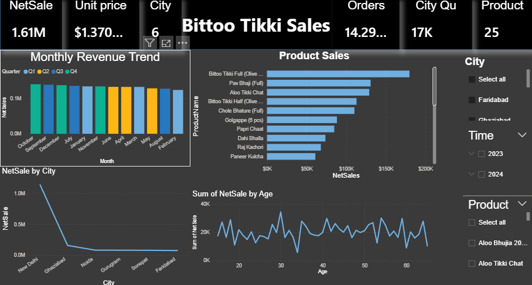
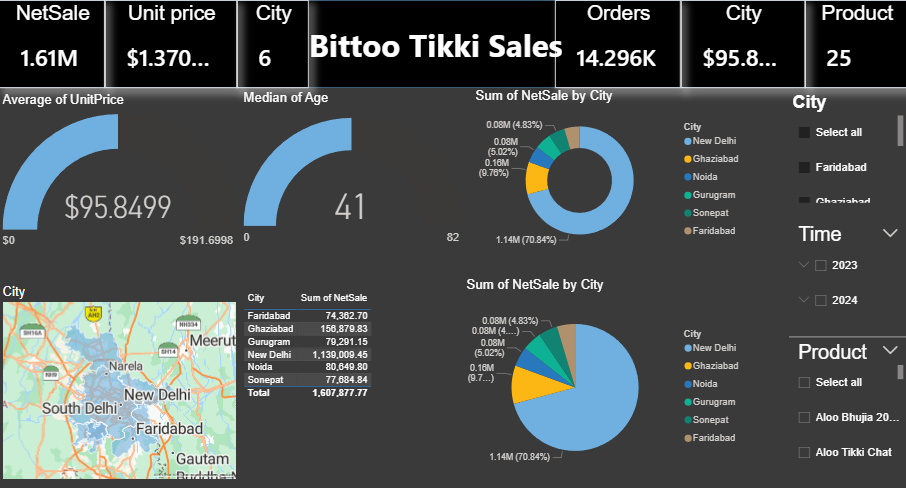
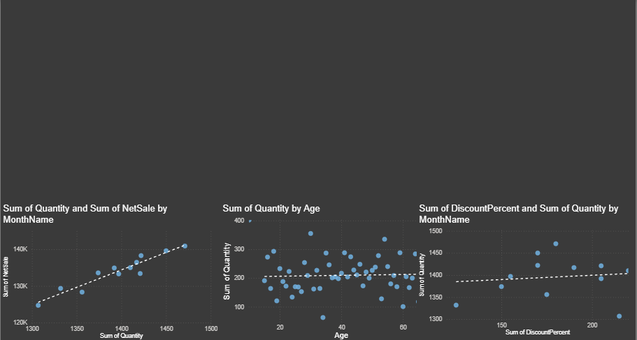
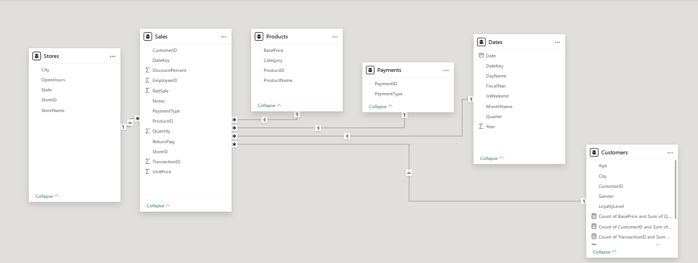

# 🍛 Bittoo Tikki Wala: Jordan Market Expansion Analysis

A Power BI business intelligence project that analyzes a year of sales from **Bittoo Tikki Wala**, an Indian street-food restaurant chain with 20 branches around Delhi, to understand what drives its revenue and to decide **whether and how it should expand into Jordan**.

## 📌 Overview
| | |
|---|---|
| **Data** | 6 tables: sales, products, stores, customers, payments, dates |
| **Period** | April 2023 to March 2024 (fiscal year 2023-24) |
| **Scope** | 20,000 order lines · 14.8K orders · ₹2.25M net sales · 20 branches in 6 cities · 25 products · 1,000 customers |
| **Tools** | Power BI (Power Query, DAX, data modeling, Azure Maps), Excel |
| **Analyses** | Sales and KPI analysis, product and category performance, branch and city performance, customer and payment behavior, correlation, SWOT, competitor and market-entry analysis |

## 🔍 What I Did
- **Modeled the data** in Power BI with `Sales` as the fact table linked to products, stores, customers, payments, and dates.
- **Prepared the data** in Power Query; for example, some unit prices are stored as text with a `₹` sign and had to be converted to numbers.
- **Built a 3-page dashboard:** KPI cards (net sales, unit price, orders, cities, products), monthly revenue trend, product sales, net sales by city on a map, sales by age, payment methods, and scatter plots for the correlation analysis, with slicers for city, time, and product.
- **Wrote DAX measures**, including a Pearson correlation measure built from scratch ([`dax/correlation_price_quantity.dax`](dax/correlation_price_quantity.dax)).
- **Measured relationships** between price, quantity, discount, customer age, and net sales.
- **Assessed the Jordan market:** customer fit, competitors, SWOT, positioning, best city and areas, payment methods, and marketing channels.
- **Delivered the findings** as a presentation and two written reports: a full market expansion report and a correlation-focused summary.

## 📊 Key Results
**What drives sales**
| Relationship | Correlation (r) | Meaning |
|---|---|---|
| Unit price ↔ Net sales | **0.73** | Higher-priced items lift revenue |
| Quantity ↔ Net sales | **0.63** | More items per order is a key growth lever |
| Discount ↔ Net sales | **≈ 0** | Current discounts do not drive sales |
| Customer age ↔ Net sales | **≈ 0** | The brand appeals across age groups |

- **Chaat is the signature category:** it brings in **54%** of net sales, followed by Main Course (27%).
- **Top products:** Bittoo Tikki Full, Pav Bhaji, Aloo Tikki Chat, and Chole Bhature.
- **Dense cities win:** **New Delhi** generates about **70%** of net sales; the best branches (Budh Vihar, Rani Bagh, Janakpuri) sit in busy, young, commercial areas.
- **Payments:** Cash 40%, Card 31%, UPI 20%, Wallet 10%, so digital payments matter.

**Recommendation for Jordan:** expand, starting with **Amman** (Sweifieh, Abdoun, Jubaiha, university districts, and malls), positioned as a **"Modern Indian Street Food"** brand rather than traditional Indian dining. Lead with Chaat products, medium prices, combos instead of discounts, a delivery-first model, local payment options (Visa, Apple Pay, CliQ, mobile wallets), and TikTok and Instagram marketing. Avoid competing head-on with burger and fried-chicken chains.

## 🖼️ Dashboard Preview
**Sales overview: KPIs, monthly trend, product sales, and sales by city and age**


**City and customer view: unit price, customer age, sales by city, and map**


**Correlation analysis: quantity, age, and discount vs. net sales**


**Data model**


## ▶️ How to View
- **Power BI:** open [`dashboards/bittoo_tikki_wala_dashboard.pbix`](dashboards/bittoo_tikki_wala_dashboard.pbix) in [Power BI Desktop](https://powerbi.microsoft.com/desktop/) (free, Windows). The data is already loaded in the file.
- **Presentation:** [`reports/Bittoo_Tikki_Wala_Market_Analysis_Presentation.pptx`](reports/Bittoo_Tikki_Wala_Market_Analysis_Presentation.pptx).
- **Written reports:** the full [Jordan market expansion report](reports/Bittoo_Tikki_Wala_Jordan_Market_Expansion_Report.docx) (22 sections: market, competitors, SWOT, pricing, marketing, expansion plan, KPIs, and risks) and the shorter [correlation-focused summary](reports/Bittoo_Tikki_Wala_Market_Analysis_EN.docx).
- **Raw data:** the six CSV files in [`data/`](data/).

## 📁 Project Structure
```
├── dashboards/
│   └── bittoo_tikki_wala_dashboard.pbix   # Power BI dashboard (3 pages)
├── dax/
│   └── correlation_price_quantity.dax     # Pearson correlation measure in DAX
├── reports/
│   ├── Bittoo_Tikki_Wala_Market_Analysis_Presentation.pptx
│   ├── Bittoo_Tikki_Wala_Jordan_Market_Expansion_Report.docx  # Full expansion report
│   └── Bittoo_Tikki_Wala_Market_Analysis_EN.docx               # Correlation-focused summary
├── data/
│   ├── Sales.csv       # 20,000 order lines
│   ├── Products.csv    # 25 products and categories
│   ├── Stores.csv      # 20 branches
│   ├── Customers.csv   # 1,000 customers (gender, age, loyalty, city)
│   ├── Payments.csv    # Payment methods
│   └── Dates.csv       # Date table
└── images/             # Dashboard screenshots
```

## 👤 Author
**Waseem Mahmoud** · [LinkedIn](https://www.linkedin.com/in/waseem-mahmoud-a34154213) · [GitHub](https://github.com/waseemalali)
